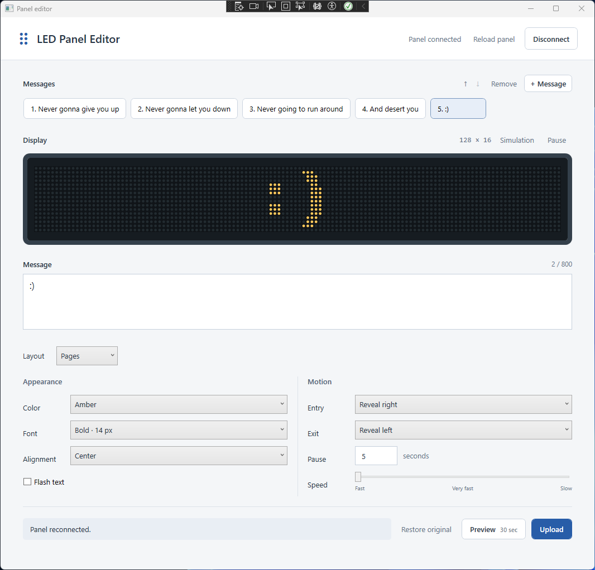

# LED Panel Editor

I found an old LED panel in storage with no drivers or original software to go
with it, and wanted to see if I could figure out how to change its messages.
This started as a fun reverse engineering test.

With the help of **GPT-6 Astra**, I worked through identifying the connection,
understanding the panel's protocol, backing up its original message, and getting
my own text onto the display. That grew into a Windows desktop editor I built with
**C# and WPF on .NET 10**, with message queues, effects, a live simulation, and
permanent uploads. The panel still runs its original firmware.



[Watch the panel demo (MP4)](assets/Demo.mp4).

## What I made

The editor loads the messages currently configured on the panel and lets you edit
their text, order, colors, fonts, entry/exit effects, speed, alignment, and pause.
You can try a message temporarily, upload a queue that survives a power cycle, or
restore the original message from its backup. The desktop simulation uses bitmap
fonts read from the panel itself and repeats the selected message as you edit it.

The app talks directly to the panel over Ethernet and opens as a normal Windows
executable, with no local web server or additional programming language required.

## The panel

I started with the label, then read information back from the panel to confirm
its dimensions and protocol version.

| Detail | Observed hardware |
| --- | --- |
| Model | TFI-16X128-50RG |
| Label date | March 2008 |
| Display | 128 x 16 pixels, red/green/amber |
| Connection used | Ethernet through an AUKEY USB Ethernet adapter |
| Protocol | JetFile II over UDP port 3001 |
| Reported CPU / protocol | `0x970A` / `0x2505` |

The USB device that Windows sees is the Ethernet adapter. The editor identifies
the panel separately by its network MAC and protocol replies, using the adapter
and panel details in a local connection profile.

## How it works

Connecting temporarily configures the selected adapter so the computer can reach
the panel, verifies the panel's identity, and reads its active playlist and message
files. A separate helper owns the adapter change and restores the settings when
the editor disconnects or closes.

Each message is encoded into the panel's existing file format, including its text
and display controls. A permanent upload backs up the current configuration,
writes new message files, and reads them back to check every byte. It then switches
the playlist and checks that the first message is playing. The original message
and its backup are preserved so the editor can restore them later.

I figured out a few of the quirks by watching what the physical panel actually
did. Long text in **Line** mode forces continuous scrolling and overrides several
effects, while **Pages** mode lets those effects work on wrapped text. I also found
that an extra playback command could skip the first queued message, and that the
inherited date/weekday schedule could leave an otherwise valid message blank.
Uploads now use an always-play schedule and let the playlist write start playback.

I confirmed that "Hello world!" appeared on the display and returned after
disconnecting and reconnecting the power. I also checked queued messages,
flashing, alignment, vertical movement, pause, and original message restoration
on the hardware. The
[protocol notes](docs/protocol.md) record the packet formats and firmware quirks,
and [validation notes](docs/desktop-validation.md) separate automated checks from
what was observed on the panel.

## Panel setup

Copy `panel.example.json` to `panel.json` beside the executable. Set the panel's
IPv4 address and MAC, the adapter's temporary IPv4 address on the same /24 subnet,
and its `PnPDeviceID`. To find the adapter ID:

```powershell
Get-NetAdapter | Select-Object Name, Status, PnPDeviceID
```

Click **Connect panel** and approve the adapter helper's Windows prompt. The
connection profile and `data/` stay beside the executable; keep them with the app
if you move it.

## Using the editor

- Connecting reads the panel's active queue and each message's settings.
- **+ Message**, **Remove**, and the arrows edit the queue and playback order.
- **Reload panel** reads the current queue, confirming before discarding edits.
- **Preview** sends the selected message for 30 seconds without saving it.
- **Upload** stores and activates the entire queue, including across power cycles.
- **Restore original** restores the message backed up on the first successful
  connection for this installation. No original message is shipped in the repository.
- The header button switches between **Connect panel** and **Disconnect**.
- Disconnecting or closing the window restores the adapter settings owned by
  the session. An independent watchdog also handles unexpected process exit.

The editor supports 1-20 messages, each containing 1-800 printable ASCII characters.
Controls include red/green/amber, four font choices, entry and exit effects, seven
speeds, pause, alignment, and flashing. The simulation repeats the selected message;
the physical panel plays the uploaded queue. Simulation timing and some transitions
remain approximate.

**Line** keeps text on one scrolling line. Overflowing text forces continuous
horizontal playback, so alignment, flash, exit, and pause controls are disabled.
**Pages** wraps text and allows those effects. Uploads and restoration use an
always-play schedule. Edits remain available while disconnected, but closing the
app does not save local drafts.

## Local data and recovery

The application creates these files alongside the executable:

```text
LedPanel.Desktop.exe
panel.example.json       Setup template included in the build
panel.json               Your local panel and adapter configuration
Networking/Scripts/      Required Windows adapter helpers
data/
    original/            Initial backup, retained for restoration
    panel-fonts.json     Panel-specific font cache
    desktop-session-*/   Transaction journals and captured packet data
    desktop-network-*   Adapter session state
```

`data/` can contain the panel's message content. Keep it and `panel.json` private;
both are excluded from Git, as is all generated build output. The repository's
fixtures use synthetic messages, playlists, and fonts. The public screenshot and
silent demo under `assets/` show newly configured example messages. The original
label photo is not distributed.

Each permanent upload backs up the current files, stages new message files, and
compares their full readback before switching the playlist. It verifies the first
entry is playing and retains a journal if completion is uncertain. Writes are not
automatically retried. An active temporary preview must finish before permanent
changes, because this firmware restores a cached playlist when a preview expires.

The initial backup under `data/original/` is verified using SHA-256 before use.
It is not overwritten on later connections, and the panel's original message file
is preserved. Move this backup with the application if you want to retain its
restore point. A new empty data directory creates a new restore point from whatever
is currently configured on the panel.

## Tests

After building the solution, run:

```powershell
dotnet run --project tests/LedPanel.Core.Tests -c Release --no-build
if ($LASTEXITCODE) { throw 'Core tests failed.' }
dotnet run --project tests/LedPanel.Desktop.Tests -c Release --no-build
if ($LASTEXITCODE) { throw 'Desktop tests failed.' }
dotnet format LedPanel.slnx --verify-no-changes --no-restore
if ($LASTEXITCODE) { throw 'Formatting check failed.' }
```

Tests cover protocol framing, malformed responses, transfer failures, queue
ordering, recovery, font-cache compatibility, preview rendering, UI bindings,
cancellation, and portable application paths. They use simulated panels and
loopback networking; running the suite does not contact a physical panel.
The checked-in fixtures are sufficient to run the tests on a fresh checkout.
Desktop rendering tests require Windows.

## Code layout

| Project | Responsibilities |
| --- | --- |
| `src/LedPanel.Core` | Editor workflows, devices, transport, protocol, messages, fonts, preview calculations, and persistence. |
| `src/LedPanel.Desktop` | WPF editor, preview control, presentation helpers, Windows networking, portable configuration, and shared styles. |
| `tests/LedPanel.Core.Tests` | Core behavior, synthetic protocol/render fixtures, and simulated devices. |
| `tests/LedPanel.Desktop.Tests` | Editor behavior, native window rendering, configuration paths, and shutdown. |

Folders and namespaces match feature boundaries, with one top-level type per file
and private helpers retained with their owning type. Core calculations have no
WPF dependency. Required adapter helpers belong to
`src/LedPanel.Desktop/Networking/Scripts/` and are copied into the application output.
See [coding standards](docs/coding-standards.md) for the C# conventions.

I tested this on the TFI-16X128-50RG panel described above. I haven't implemented
firmware extraction, date/time scheduling, sound control, or support for other
controllers.
